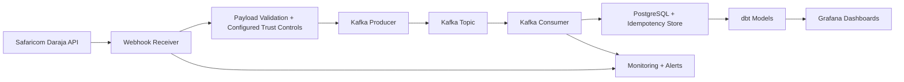

<p align="center">
  
</p>

# M-Pesa Real-Time Transaction Streaming Pipeline

A portfolio implementation of a real-time M-Pesa event pipeline, designed to demonstrate ingestion, event streaming, persistence, analytics, and operational monitoring. Security and delivery guarantees are being validated incrementally; this repository is not a claim of production readiness.

## Executive summary

This project implements a real-time fintech event pipeline that ingests Safaricom Daraja callbacks, protects against replay and duplicate transactions, streams events through Kafka, stores durable records in PostgreSQL, and exposes operational and business dashboards through Grafana and dbt-driven analytics models.

It is designed to reflect the operational patterns expected in modern payment and transaction systems:

- webhook validation and replay protection
- durable idempotency and message state tracking
- Kafka producer/consumer resilience with retry and DLQ flow
- health checks, monitoring, and alert thresholds
- release controls and environment-safe configuration

---

## What the platform does

- Accepts and validates M-Pesa webhook events from the Safaricom API
- Rejects replayed or duplicate transactions before they reach business processing
- Publishes events to Kafka for asynchronous, scalable processing
- Tracks consumer retries, dead-letter handling, and processing state in the database
- Stores verified transaction and operational data for analytics and reconciliation
- Exposes operational dashboards and quality checks for real-time platform monitoring

---

## Architecture at a glance



---

## Key implementation areas

- Ingestion and validation: Flask-based webhook receiver with schema checks and configurable custom HMAC; custom HMAC is not proof of Safaricom origin (see `docs/security/WEBHOOK_TRUST_MODEL.md`)
- Event streaming: Kafka producer/consumer pipeline with retry and DLQ logic
- Persistence: PostgreSQL-backed transactional and idempotency state tracking
- Analytics and quality: dbt models, staging and marts, and data-quality checks
- Observability: health monitoring, alert rules, and Grafana operational views
- Release discipline: environment-config enforcement, production approvals, rollback docs, and health gates

---

## Reliability and security design

The repository implements or configures several production-inspired controls. These must be verified in the target environment before describing the system as production-ready; configuration alone is not evidence of a tested guarantee:

- credentials are expected to be supplied through environment configuration; repository/history scanning is still required before production use
- configurable custom HMAC and replay/idempotency controls exist, but callback sender authenticity and distributed failure behavior require deployment-specific verification
- database idempotency helpers and Kafka retry/DLQ components require concurrency and end-to-end tests before guarantees can be claimed
- dashboards, alert rules, and operational documentation are present, but alert delivery and recovery procedures still need to be exercised

---

## Repository layout

- app/ — FastAPI app, config, and runtime settings
- ingestion/ — webhook receiver, Kafka producer/consumer, health checks, DLQ logic
- dashboards/ — Grafana dashboard definitions and provisioners
- dbt/ — transformation and analytics models
- monitoring/ — Prometheus and alert rules
- kubernetes/ — production deployment manifests and namespace wiring
- docs/ — runbook, rollback, architecture, SLO, and incident response docs
- tests/ — unit and smoke validation for config and idempotency behavior

---

## Quick start

### 1. Clone the repository

```bash
git clone https://github.com/Victor-Kipruto-Rop/Real_Time_Transaction_Streaming-MPESA-.git
cd Real_Time_Transaction_Streaming-MPESA-
```

### 2. Configure local secrets

Copy the example environment file and set strong, unique local development values before starting the stack. Do not use production credentials in local development.

```bash
cp .env.example .env
# Edit .env and set at least POSTGRES_PASSWORD and GRAFANA_ADMIN_PASSWORD.
# Set UI_TOKEN if you want to use the browser webhook demo.
```

### 3. Validate and start the stack

```bash
docker compose config --quiet
make infra-up
```

### 4. Check service health

```bash
curl --fail --silent --show-error http://localhost:5000/health | python -m json.tool
```

### 5. Send a sample transaction event

```bash
curl -s -X POST http://localhost:5000/webhook/c2b/confirmation \
  -H 'Content-Type: application/json' \
  -d '{"TransID":"TXN123","TransAmount":"500","MSISDN":"254712345678","AccountReference":"ACC001","TransTime":"20260514120000"}'
```

The sample payload is synthetic. A successful HTTP response does not by itself prove that a transaction was persisted, processed by Kafka, or reconciled against an independent ledger.

---

## Validation and release quality

The project includes automated verification around the runtime contract and production gate logic. The baseline validation run is:

```bash
python3 -m pytest tests/unit/test_config_loading.py tests/unit/test_idempotency_store.py tests/e2e/smoke_tests.py -q
```

This validates the environment configuration contract, database-backed idempotency store behavior, and end-to-end smoke coverage.

---

## Operational documentation

- [docs/ARCHITECTURE.md](docs/ARCHITECTURE.md) — detailed architecture and responsibilities
- [docs/PRODUCTION_RUNBOOK.md](docs/PRODUCTION_RUNBOOK.md) — release and deployment process
- [docs/ROLLBACK_CHECKLIST.md](docs/ROLLBACK_CHECKLIST.md) — rollback procedure and verification
- [docs/EMERGENCY_RESPONSE.md](docs/EMERGENCY_RESPONSE.md) — incident workflow and comms flow
- [docs/SERVICE_SLOS.md](docs/SERVICE_SLOS.md) — service targets and alerting guardrails
- [docs/PRODUCTION_DASHBOARD_PACK.md](docs/PRODUCTION_DASHBOARD_PACK.md) — dashboard pack and ops view map
- [docs/RELEASE_CHECKLIST.md](docs/RELEASE_CHECKLIST.md) — production release checklist

---

## Ownership and contact

Victor Kipruto Rop

GitHub: https://github.com/Victor-Kipruto-Rop  
Email: kiprutovictor39@gmail.com

---

## Summary

This repository is a real-time transaction streaming and analytics project designed for reproducible evaluation and further hardening. Treat it as a production-style portfolio/demo system until the deployment-specific security controls, failure recovery, load tests, and end-to-end processing guarantees have been independently exercised. Do not use real customer or production payment data in the demo environment.