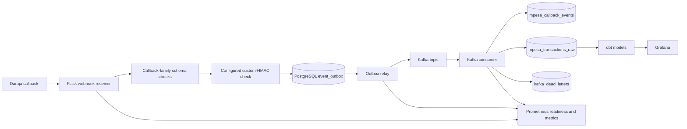

# Architecture and Delivery Semantics

## Purpose

A portfolio implementation of a real-time M-Pesa callback ingestion and streaming pipeline. The architecture emphasizes durable acceptance, asynchronous delivery, callback auditing, transaction persistence, and operational evidence. It is not a claim of production readiness or official Safaricom callback authentication.

## High-level architecture

## Callback acceptance

1. The receiver bounds request size, applies rate limiting, validates the payload shape for the route, and checks the configured custom-HMAC policy.
2. The receiver calculates a stable callback-scoped event key and inserts the callback envelope into PostgreSQL `event_outbox`.
3. The HTTP endpoint acknowledges the callback only after the outbox transaction commits. A retry for the same event key is acknowledged without creating another outbox row.
4. C2B validation, C2B confirmation, B2C result, and STK callback events are kept distinct by callback type and provider identifiers where available.

### Trust boundary

The optional HMAC is an application-specific shared-secret mechanism for senders that are configured to use the same canonical JSON signing scheme. It is **not proof that a callback originated from Safaricom**. Do not enable it for a provider callback unless the sender actually produces that signature. Provider-approved callback trust settings must be confirmed for the target account and deployment.

## Outbox relay and delivery guarantee

- The relay claims pending rows with a time-limited lease, publishes the event to Kafka, and marks the row published only after the Kafka delivery callback reports success.
- Failed sends are returned to pending with bounded exponential backoff. A stale lease allows recovery after a relay process restart.
- A crash after Kafka delivery but before the outbox status update may cause the event to be sent again.

**Guarantee: at-least-once delivery.** The project does not claim exactly-once end-to-end delivery. Consumers and downstream transformations must remain idempotent.

## Consumer persistence and dead letters

- Every successfully handled callback is recorded in `mpesa_callback_events` for audit.
- Only a `c2b_confirmation` event is allowed to upsert `mpesa_transactions_raw`; C2B validation is a pre-transaction decision and is not evidence that payment was received.
- If a message is malformed or cannot be validated, the consumer writes its topic, partition, offset, raw value, and error details to `kafka_dead_letters`.
- The consumer commits a poison-message offset only after the DLQ insert commits. If PostgreSQL is unavailable, it leaves the offset uncommitted so the message can be retried.
- A durable DLQ table exists; replay tooling, operator disposition, and retention policy still require implementation and operational validation.

## Database schema lifecycle

- `alembic upgrade head` is the versioned schema entry point.
- Docker Compose runs a one-shot `migrate` service before the webhook receiver, relay, and consumer.
- The baseline/bridge migration creates missing ORM tables and the raw transaction table. It does not delete duplicate transaction records; it will fail if a unique transaction index cannot be established on existing data.
- Test fresh-database upgrade, repeated upgrade, and upgrade against a sanitized snapshot of an existing database before using this migration path for a real deployment.
- Do not run destructive downgrades. Restore from a verified backup or use a reviewed forward migration.

## Observability

- Webhook receiver: `/health` for liveness, `/ready` for PostgreSQL/outbox readiness, and `/metrics` for Prometheus metrics.
- Kafka consumer: Prometheus metrics on port 8080 for handled messages, database failures, dead-letter count, and estimated consumer lag.
- Outbox relay: Prometheus metrics on port 8081 for publish outcomes, pending count, and oldest pending age.
- Prometheus scrape targets and alert rules cover outbox backlog, outbox publish failures, consumer database failures, and DLQ events.
- Metrics endpoints should remain on a trusted network or be restricted at the reverse proxy. Alert delivery must be tested in the target environment.

## Testing and operational readiness

Automated tests cover callback shape validation, event identity, outbox idempotency/retry behavior, database DDL, and intended PostgreSQL/Kafka integration flows. The integration job is designed to run against disposable services and upload artifacts, including a bounded synthetic load smoke test and a backup/restore exercise.

A passing workflow and artifact review are still required before these capabilities can be described as verified. A CI test does not replace staging verification with provider-approved trust settings, a real alert-delivery test, dependency/security review, concurrency/failure injection, or a representative migration test.

Operational runbook: `docs/operations/OPERATIONAL_READINESS.md`.
